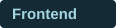
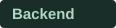
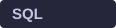
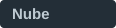

<!-- Textos editables y componentes SVG propios en assets/. -->

<table>
<tr>
<td width="76%" valign="top">
<h3>René Rosales · Sito</h3>

Soy de <strong>El Salvador</strong> y estudio <strong>Ingeniería en Sistemas y Redes Informáticas</strong>.

Me gusta unir programación, redes y creatividad para construir herramientas útiles. Aprendo creando proyectos, probando ideas y mejorando cada detalle de la experiencia.

</td>
<td width="24%" align="center" valign="middle">

</td>
</tr>
<tr>
<td colspan="2">

<strong>Lo que me mueve</strong>

<ul>
<li><strong>Software para la vida real.</strong> Crear aplicaciones que ayuden a organizar tareas, administrar negocios y simplificar el trabajo cotidiano.</li>
<li><strong>Inteligencia artificial y automatización.</strong> Explorar asistentes personales, interacción por voz y nuevas formas de conectar herramientas.</li>
<li><strong>Redes, Linux y dispositivos.</strong> Aprender cómo se conectan los sistemas y experimentar con servidores, electrónica y robótica.</li>
</ul>
</td>
</tr>
</table>

<table>
<tr><td width="150"></td><td width="780"><a href="https://flutter.dev/">&nbsp; Flutter</a> &nbsp; &nbsp; <a href="https://dart.dev/">&nbsp; Dart</a> &nbsp; &nbsp; <a href="https://www.typescriptlang.org/">&nbsp; TypeScript</a></td></tr>
<tr><td></td><td><a href="https://www.python.org/">&nbsp; Python</a> &nbsp; &nbsp; <a href="https://supabase.com/">&nbsp; Supabase</a></td></tr>
<tr><td></td><td><a href="https://www.postgresql.org/">&nbsp; PostgreSQL</a></td></tr>
<tr><td> Explorando</td><td><a href="https://azure.microsoft.com/">&nbsp; Azure</a> &nbsp; &nbsp; <a href="https://console.cloud.google.com/">&nbsp; Google Cloud</a></td></tr>
</table>

Control de versiones &nbsp; <a href="https://git-scm.com/">&nbsp; Git</a>

<strong>Conoce más sobre mis proyectos</strong>

### Niko
Un asistente personal con inteligencia artificial, interacción por voz y un compañero pixelado para el día a día.

### Mubos
Un sistema de inventario y punto de venta pensado para facilitar el trabajo de los negocios.

### Sito Lab
Mi proyecto de papelería creativa y experiencias de personalización. [Explorar Sito Lab →](https://sitolab.shop/)

---

Construyendo, aprendiendo y dando vida a nuevas ideas. ✦ René + Niko

