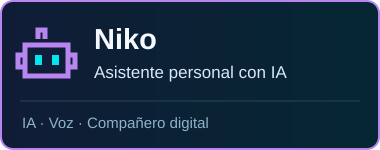
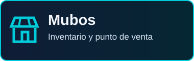
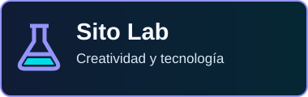

<!-- Textos editables y componentes SVG propios en assets/. -->

<table>
<tr>
<td width="76%" valign="top">
<h3>René Rosales · Sito</h3>

Soy de <strong>El Salvador</strong> y estudio <strong>Ingeniería en Sistemas y Redes Informáticas</strong>.

Me gusta unir programación, redes y creatividad para construir herramientas útiles. Aprendo creando proyectos, probando ideas y mejorando cada detalle de la experiencia.

</td>
<td width="24%" align="center" valign="middle">

</td>
</tr>
<tr>
<td colspan="2">

<strong>Lo que me mueve</strong>

<ul>
<li><strong>Software para la vida real.</strong> Crear aplicaciones que ayuden a organizar tareas, administrar negocios y simplificar el trabajo cotidiano.</li>
<li><strong>Inteligencia artificial y automatización.</strong> Explorar asistentes personales, interacción por voz y nuevas formas de conectar herramientas.</li>
<li><strong>Redes, Linux y dispositivos.</strong> Aprender cómo se conectan los sistemas y experimentar con servidores, electrónica y robótica.</li>
</ul>
</td>
</tr>
</table>

Enlaces de las tecnologías

**Frontend:** [Flutter](https://flutter.dev/) · [Dart](https://dart.dev/) · [TypeScript](https://www.typescriptlang.org/)

**Backend:** [Python](https://www.python.org/) · [Supabase](https://supabase.com/)

**SQL:** [PostgreSQL](https://www.postgresql.org/)

**Nube · explorando:** [Azure](https://azure.microsoft.com/) · [Google Cloud Console](https://console.cloud.google.com/)

Control de versiones &nbsp; <a href="https://git-scm.com/"> Git</a>

Conoce los proyectos

### Niko
Un asistente personal con inteligencia artificial, interacción por voz y un compañero pixelado para el día a día.

### Mubos
Un sistema de inventario y punto de venta pensado para facilitar el trabajo de los negocios.

### Sito Lab
Papelería creativa y experiencias de personalización. [Visitar Sito Lab →](https://sitolab.shop/)

### [Perfil con Niko](https://github.com/Fourecks/Fourecks)
El código de este perfil: componentes SVG, animaciones y un calendario conectado a las contribuciones públicas de GitHub.

[Ver código](https://github.com/Fourecks/Fourecks) · [Licencia MIT](https://github.com/Fourecks/Fourecks/blob/main/LICENSE) · [Proponer una mejora](https://github.com/Fourecks/Fourecks/issues/new)

Mini proyectos con código público

| Proyecto | Descripción | Código |
| :--- | :--- | :--- |
| Pomodoro Timer | Mini proyecto de temporizador | [Ver repositorio](https://github.com/Fourecks/Pomodoro_Timer) |
| To-do List | Mini proyecto de lista de tareas | [Ver repositorio](https://github.com/Fourecks/To-do-list) |

Estos dos repositorios todavía no tienen definida una licencia de reutilización.

Actividad pública de GitHub · Actualización diaria · [Ver calendario original](https://github.com/Fourecks?tab=overview)

¿Tienes una idea, una pregunta o un proyecto en mente? Puedes escribirme por Instagram o compartir una propuesta en GitHub.

Construyendo, aprendiendo y dando vida a nuevas ideas. ✦ René + Niko

