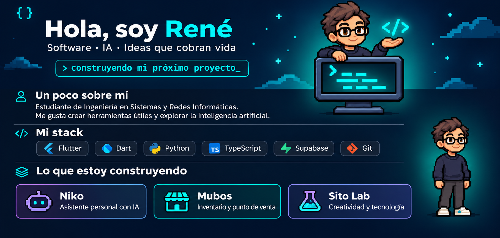

<a href="https://sitolab.shop/">Sito Lab</a> &nbsp; · &nbsp; <a href="https://www.instagram.com/rrosales.dev/">Instagram</a>

Sobre mí y mis proyectos · versión en texto

Soy **René Rosales (Sito)**, de El Salvador. Estudio Ingeniería en Sistemas y Redes Informáticas. Me gusta crear herramientas útiles y explorar la inteligencia artificial.

**Tecnologías:** Flutter · Dart · Python · TypeScript · Supabase · Git.

- **Niko:** asistente personal con IA.
- **Mubos:** inventario y punto de venta.
- **[Sito Lab](https://sitolab.shop/):** creatividad y tecnología.

