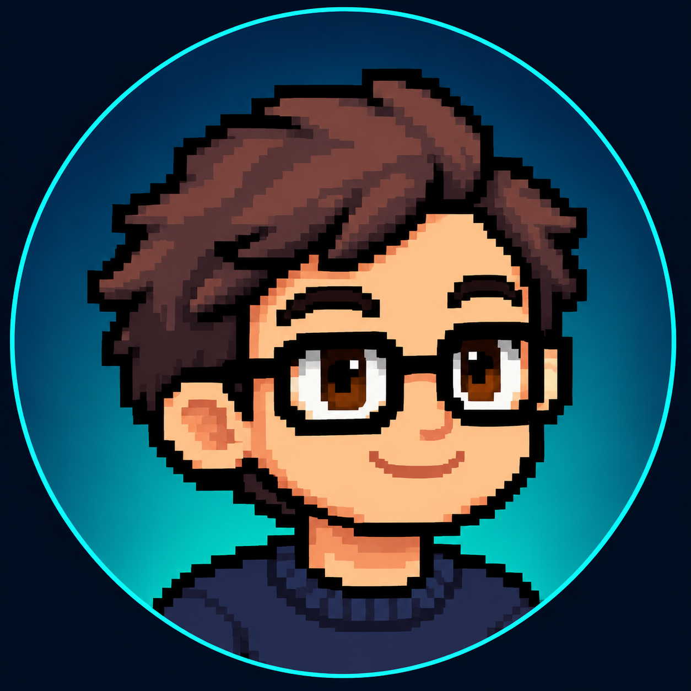

# Hola, soy René ✦

### Software · IA · Ideas que cobran vida

`> construyendo mi próximo proyecto_`

---

## 👋 Un poco sobre mí

<table>
<tr>
<td width="72%" valign="top">

Estudiante de **Ingeniería en Sistemas y Redes Informáticas** en El Salvador 🇸🇻.

Me gusta crear herramientas útiles, explorar la inteligencia artificial y convertir ideas en proyectos.

</td>
<td width="28%" align="center" valign="middle">

**RENÉ + NIKO** 
*aprendiendo y construyendo*

</td>
</tr>
</table>

## 🧰 Mi stack

## 🚀 Lo que estoy construyendo

<table>
<tr>
<td width="33%" valign="top">

### 🤖 Niko
Asistente personal con IA y un compañero pixelado para el día a día.

</td>
<td width="33%" valign="top">

### 🏪 Mubos
Herramientas para inventario y punto de venta pensadas para negocios.

</td>
<td width="33%" valign="top">

### 🎨 Sito Lab
Papelería creativa y experiencias personalizadas.

[Visitar Sito Lab →](https://sitolab.shop/)

</td>
</tr>
</table>

## 🔗 Conectemos

Construyendo, aprendiendo y dando vida a nuevas ideas. ✦ René + Niko

