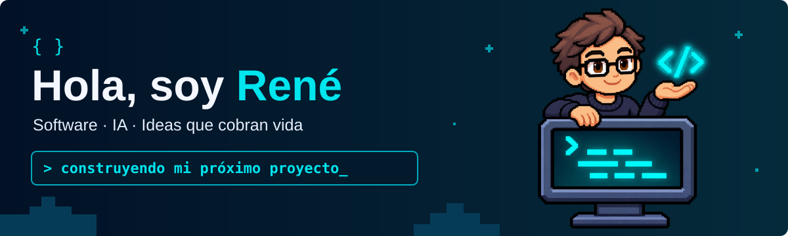
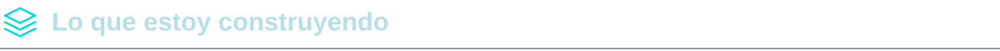

<!-- Textos editables y componentes SVG propios en assets/. -->

<a href="#sobre-mí">Sobre mí</a> &nbsp; · &nbsp; <a href="#tecnologías">Tecnologías</a> &nbsp; · &nbsp; <a href="#proyectos">Proyectos</a> &nbsp; · &nbsp; <a href="https://www.instagram.com/rrosales.dev/">Conectemos ↗</a>

Estudiante de **Ingeniería en Sistemas y Redes Informáticas**, de El Salvador. Me gusta crear herramientas útiles, explorar la inteligencia artificial y convertir ideas en proyectos.

<strong>Conoce más sobre mis proyectos</strong>

### Niko
Un asistente personal con inteligencia artificial, interacción por voz y un compañero pixelado para el día a día.

### Mubos
Un sistema de inventario y punto de venta pensado para facilitar el trabajo de los negocios.

### Sito Lab
Mi proyecto de papelería creativa y experiencias de personalización. [Explorar Sito Lab →](https://sitolab.shop/)

---

Construyendo, aprendiendo y dando vida a nuevas ideas. ✦ René + Niko

